# Learning Flow Maps of Jump-Diffusion SDEs — Poster Materials

This folder collects every result figure produced across the three problems
of this project, with descriptions and numbers, so they can be dropped
directly into an APS-style poster. All figures referenced below are copied
into `figures/` next to this file (paths are relative, so the images render
if you view this README in any Markdown viewer).

**Figure numbering used on this page:** `P1.x` = Problem 1, `P2.x` =
Problem 2, `P3.x` = Problem 3. Cite figures by these labels on the poster.

---

## 1. Why we are solving this

Runaway electrons (REs) are a major concern for large tokamaks (ITER-scale
devices): during a plasma disruption, the toroidal electric field spikes and
a small population of electrons can be accelerated faster than collisional
drag can stop them, "running away" to relativistic energies. These
electrons can multiply through an **avalanche** of large-angle ("knock-on")
collisions [Rosenbluth & Putvinski, *Nucl. Fusion* 37, 1355 (1997)], and the
resulting relativistic electron beam can seriously damage plasma-facing
components when it's lost.

Predicting *whether* and *how fast* electrons cross the runaway threshold is
naturally an **exit-time problem** for a stochastic process on a bounded
domain [Yang, Zhang, del-Castillo-Negrete, Stoyanov, *J. Comput. Phys.* 444,
110564 (2021)]. The physics has two very different collisional
contributions — many small-angle (grazing) collisions that behave like
ordinary diffusion, and rare large-angle (knock-on) collisions that transfer
a big momentum chunk in a single event — so the correct mathematical object
is a **jump-diffusion stochastic differential equation (SDE)**, not a plain
SDE.

Simulating this with a classical fine time-stepping integrator is accurate
but slow (hundreds to thousands of sub-steps per unit of physical time).
The goal of this project is to **learn the large-time-step stochastic flow
map** of the jump-diffusion with a *training-free* diffusion-model method
[Liu, Yang, Zhang, Bao, Cao, Zhang, *J. Mach. Learn. Model. Comput.* 5(1),
25–38 (2024); Yang, Liu, del-Castillo-Negrete, Cao, Zhang, *J. Comput.
Phys.*, 114434 (2025)], plus a classifier for the exit event — so that one
network evaluation replaces hundreds of numerical sub-steps, with
controlled accuracy loss.

Three problems were solved, in increasing order of realism:
- **Problem 1** — a 1D bounded jump-diffusion with *constant* coefficients:
  proves the method works on a domain with absorbing walls and jumps.
- **Problem 2** — the same 1D domain but with *state-dependent*
  coefficients: proves the learned model actually conditions on position,
  not just fitting one global law.
- **Problem 3** — the real 2D runaway-electron model in momentum space
  $(p,\xi)$: the actual physics target, verified step-by-step before any ML
  was applied, then learned.

---

## 2. The governing equations

### 2.1 General jump-diffusion form (the note, Eq. 2)

$$
dX_t = \underbrace{b(X_t)\,dt}_{\text{drift}}
      + \underbrace{\sigma(X_t)\,dW_t}_{\text{diffusion}}
      + \underbrace{\int \gamma(X_{t^-},z)\,\tilde N(dt,dz)}_{\text{jumps}}
$$

Small-angle Coulomb collisions accumulate into the Gaussian diffusion term
(classical Fokker–Planck picture); rare large-angle "knock-on" collisions
are discrete, Poisson-timed, and heavy-tailed (Møller cross-section
$d\Sigma/d\epsilon\propto\epsilon^{-2}$) — exactly the jump term.

### 2.2 The 2D runaway-electron model (the note, Eqs. 1, 3–4)

State $X_t=(p,\xi)$: $p$ = momentum normalized by $m_ec$, $\xi=\cos\theta$ =
pitch-angle cosine.

$$
b_p = \hat E\,\xi - F_{\rm drag}(p), \qquad F_{\rm drag}(p)\sim\frac{1+p^2}{p^2}
$$
$$
b_\xi = \frac{\hat E(1-\xi^2)}{p}, \qquad
d\xi \supset \sqrt{2\,\nu_D(p)(1-\xi^2)}\;dW_\xi
$$

$\hat E=E/E_c$ is the field normalized by the Connor–Hastie critical field;
$F_{\rm drag}$ falls off like $1/p^2$ at high $p$ — **this is why runaways
exist**: drag becomes negligible while the field term does not. The
momentum domain is bounded by the runaway separatrix $p_c$: below it the
electron rejoins the thermal bulk (absorbing exit).

The code implements the **full** version of this model (`common_2.py`),
adding a synchrotron radiation-reaction loss term and an explicit
compound-Poisson knock-on jump process with an analytic Møller
cross-section, calibrated against [Embréus, Stahl, Fülöp, *J. Plasma Phys.*
84, 905840102 (2018)]:

$$
b_p = \hat E\xi - F_{\rm drag}(p) - \frac{\gamma p(1-\xi^2)}{\tau_{\rm syn}},
\qquad
b_\xi = \frac{\hat E(1-\xi^2)}{p} + \frac{\xi(1-\xi^2)}{\tau_{\rm syn}\gamma} - \xi\nu_c
$$

with jump rate $\lambda(p) = R\,\beta(p)\,\hat\sigma(\gamma)/(4\ln\Lambda)$
and jump energy transfer sampled from the heavy-tailed Møller spectrum.
Domain: $p\in[1,10]$ (absorbing both ends), $\xi\in[-1,1]$ (reflecting).

### 2.3 The 1D verification model (the note, Eq. 5)

$$
dX_t = \sigma_b\,dW_t + dJ_t, \qquad X_t\in[0,6]
$$

$J_t$ a compound-Poisson process (rate 1, jump size $Y\sim\mathcal
N(0,0.7^2)$), $\sigma_b=0.7$, big step $\Delta t=1$, absorbing boundaries at
both ends. This is the toy model the note uses to argue the method will
transfer to the 2D problem; the actual code (`common_1.py`) implements a
closely related pair of models — **BD** (constant coefficients) and **BSD**
(state-dependent coefficients) — described in Problems 1–2 below.

### 2.4 What is actually learned

For a large step $\Delta t$, instead of integrating with many small
sub-steps, we learn:
1. **The survivor flow map** $G(x,z)\to\Delta x$, $z\sim\mathcal N(0,I)$: a
   network trained so that $x+G(x,z)$ samples the true conditional
   transition density $p(X_{t+\Delta t}\mid X_t=x, \text{survive})$. Fit in
   two stages so it doesn't collapse to the conditional mean: (1)
   *training-free* labels via a KNN neighborhood + probability-flow ODE,
   (2) MSE distillation into a small network.
2. **The exit classifier** $E(x)=\Pr(\text{exit during }\Delta t\mid x)$
   (binary in 1D, 3-class stay/exit-low/exit-high in 2D), trained by
   cross-entropy.

Inference is **exit, then propagate**: the exit head removes particles that
cross a boundary this step; the flow map (trained only on true survivors)
advances the rest — so the flow map is never evaluated out of its training
distribution, even over a long rollout.

---

## 3. Problem 1 — 1D bounded jump-diffusion, constant coefficients ("BD")

$dx = \sigma_b\,dW_t + \text{jumps}$ on $[0,6]$, absorbing ends. Jump rate
$\lambda=1.0$ (constant), jump size $\sim\mathcal N(1.5, 0.3^2)$ — jumps are
biased upward, mimicking a knock-on collision that kicks momentum up, which
makes the one-step density **multimodal** (one lobe per possible jump
count). $\sigma_b=0.4$. This is the simplest possible test: can the method
learn a bounded, multimodal, jump-driven transition + the exit boundary?

| Fig | File | Description |
|---|---|---|
| P1.1 | `figures/problem1_bd/B0_onestep.png` | One-step sub-probability transition density, ML flow map (red) vs numerical ground truth (gray), at two fixed starts — exit mass shows up as missing area under the curve. |
| P1.2 | `figures/problem1_bd/B1_onestep.png` | *Left:* exit probability $P(\text{exit}\mid x)$, learned exit head (red dashed) vs Monte Carlo (black) — a clean, symmetric U-shape. *Middle/right:* survivor transition density at $x=1.5,3$, clearly **bimodal** (jump-count mixture), flow map vs numerical. |
| P1.3 | `figures/problem1_bd/B2_rollout.png` | Long rollout to $T=4$ ($K=4$ big ML steps vs 800 numerical sub-steps): surviving fraction per step, and terminal density at $T=4$. |

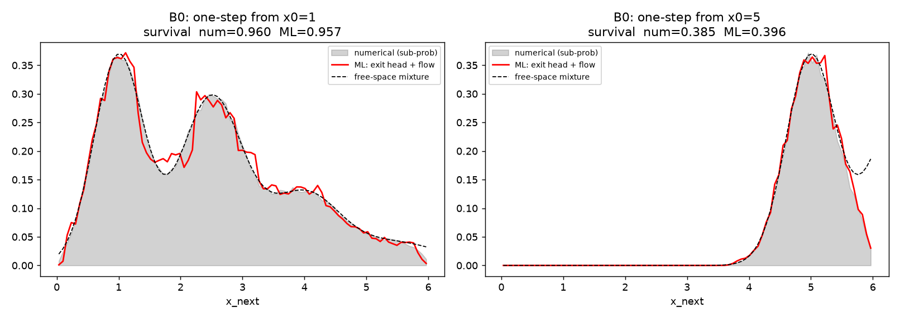
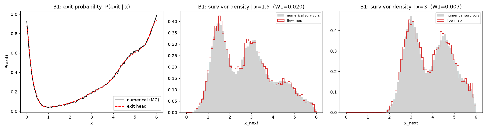
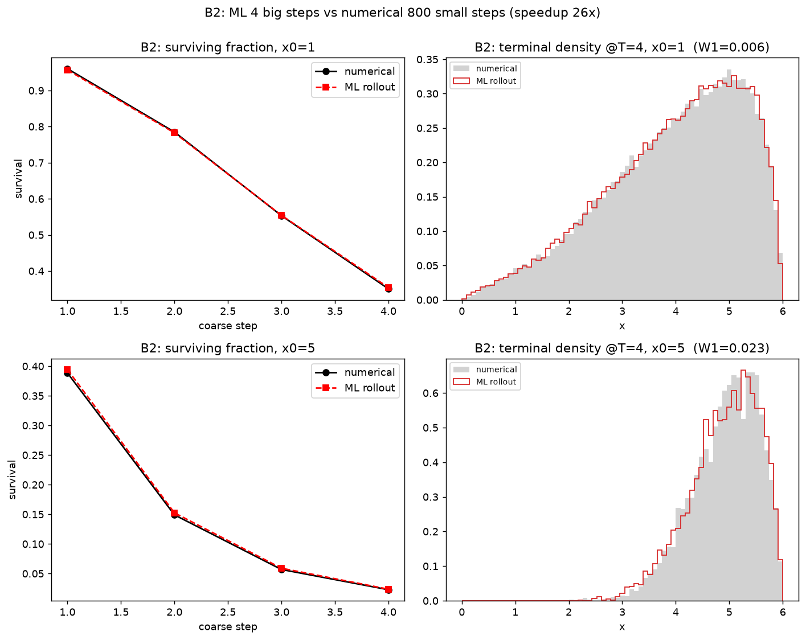

**Numbers** (`runaway_flowmap/artifacts_bd/metrics.json`):

| Metric | Value |
|---|---|
| B0 survival, $x_0=1$: numerical / ML | 0.960 / 0.957 |
| B0 survival, $x_0=5$: numerical / ML | 0.385 / 0.396 |
| B1 exit-probability max abs error (whole domain) | 0.051 |
| B1 survivor-density Wasserstein-1 ($x=1.5$, $x=3$) | 0.020, 0.007 |
| B2 final survival, $x_0=1$: numerical / ML | 0.351 / 0.354 |
| B2 final survival, $x_0=5$: numerical / ML | 0.023 / 0.024 |
| B2 terminal Wasserstein-1 | 0.006, 0.023 |
| **Speedup** (4 big ML steps vs 800 numerical sub-steps) | **26.5×** |

---

## 4. Problem 2 — 1D bounded jump-diffusion, state-dependent coefficients ("BSD")

Same domain $[0,6]$, but now **every** coefficient depends on $x$:
mean-reverting drift $b(x)=\kappa(x^*-x)$ toward $x^*=2.5$, diffusion
$\sigma(x)=\sigma_0+\sigma_1x$, jump rate $\lambda(x)=\lambda_0+\lambda_1x$
(decreasing in $x$), jump-size mean $=j_0+j_1x$ (also decreasing). This
stress-tests whether the network's *conditioning* on $x$ actually works, not
just whether it can fit one global law.

| Fig | File | Description |
|---|---|---|
| P2.1 | `figures/problem2_bsd/B0_onestep.png` | Same one-step sub-probability comparison as P1.1, for the state-dependent model. |
| P2.2 | `figures/problem2_bsd/B1_onestep.png` | Exit probability curve — much steeper/more asymmetric than BD (mean-reversion keeps most particles away from both walls, so $P(\text{exit})\approx0$ across most of the domain, then rises sharply only very close to each wall) — and survivor densities at $x=1.5,3$. |
| P2.3 | `figures/problem2_bsd/B2_rollout.png` | Long rollout to $T=8$ ($K=8$ big steps vs 1600 sub-steps). |

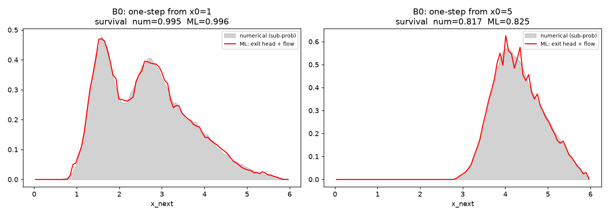
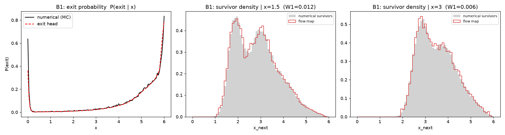
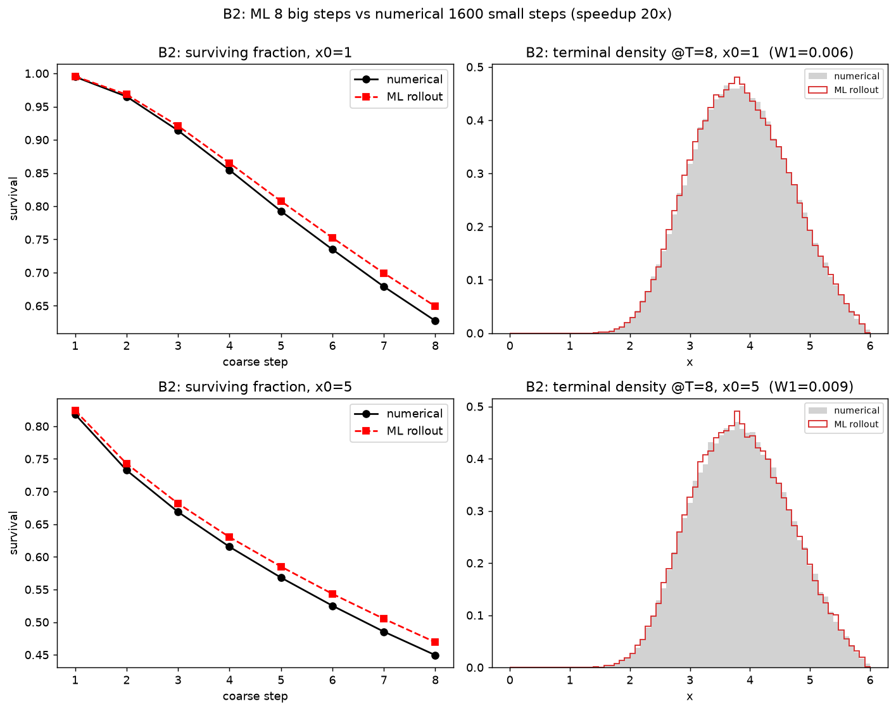

**Numbers** (`runaway_flowmap/artifacts_bsd/metrics.json`):

| Metric | Value |
|---|---|
| B0 survival, $x_0=1$: numerical / ML | 0.995 / 0.996 |
| B0 survival, $x_0=5$: numerical / ML | 0.817 / 0.825 |
| B1 exit-probability max abs error (whole domain) | **0.275** |
| B1 survivor-density Wasserstein-1 ($x=1.5$, $x=3$) | 0.012, 0.006 |
| B2 final survival, $x_0=1$: numerical / ML | 0.627 / 0.649 |
| B2 final survival, $x_0=5$: numerical / ML | 0.449 / 0.469 |
| B2 terminal Wasserstein-1 | 0.006, 0.009 |
| **Speedup** (8 big ML steps vs 1600 numerical sub-steps) | **19.9×** |

**Takeaway (good poster point):** BSD's worst-case exit-probability error
(0.275) is **5× larger** than BD's (0.051), even though the survivor-density
and long-horizon rollout errors are just as good or better. State-dependence
specifically stresses the *exit head* near the rarely-visited, sharply
peaked boundary region — a difficulty that carries over directly into the
2D problem's exit classifier (§6).

---

## 5. Problem 3 — 2D runaway-electron model: physics verification (no ML yet)

Before any learning was attempted, the ground-truth simulator itself
(`common_2.py`) was verified figure-by-figure, like a computational plasma
physicist would, at the default parameters $\hat E=2$, $Z=1$,
$\tau_{\rm syn}=100$, $\ln\Lambda=15$, $\epsilon_{\min}=0.02$,
$p\in[1,10]$.

| Fig | File | Description |
|---|---|---|
| P3.1 | `figures/problem3_physics/fig01_state_space.png` | Schematic state-space diagram: $(p,\xi)$ domain, the two **absorbing** walls ($p_{\min}$=thermalization, $p_{\max}$=runaway) vs. the two **reflecting** walls ($\xi=\pm1$), with illustrative trajectory types (thermalized / runaway / reflecting bounce / knock-on jump). |
| P3.2 | `figures/problem3_physics/fig02_drift_field.png` | Deterministic drift vector field $(b_p,b_\xi)$ from `re2d_coeffs`, quiver plot colored by $b_p$, with the $b_p=0$ nullcline overlaid — a deterministic approximation to the "runaway separatrix" $p_c$. |
| P3.3 | `figures/problem3_physics/fig03_brownian_traj.png` | Pure diffusion (jumps disabled): trajectory bundles + ensemble-variance-vs-time. **Key finding:** although $p$ has *no* direct noise term, its ensemble variance grows *faster* than $\xi$'s (which saturates against the reflecting wall) — because $p$ integrates the history of the diffusing $\xi$. |
| P3.4 | `figures/problem3_physics/fig04_jump_traj.png` | Jumps enabled, diffusion still on: trajectories with knock-on jump segments highlighted in black — clear discontinuities vs. the smooth diffusive wiggle, plus a single-trajectory $p(t)$/$\xi(t)$ time series showing literal vertical jumps in $p(t)$. |
| P3.5 | `figures/problem3_physics/fig05_knock_rate.png` | Knock-on collision rate $\lambda(p)$, decomposed into its shape factors $\beta(p)$ (speed, rising) and $\hat\sigma(\gamma)$ (Møller cross-section, falling) — they nearly cancel, so $\lambda(p)$ is close to flat across the whole domain. Right panel: sensitivity to the $\epsilon_{\min}$ FP/jump-split threshold. |
| P3.6 | `figures/problem3_physics/fig06_drift_components.png` | $b_p(p)$ at several fixed $\xi$ (zero-crossings = separatrix points, cross-validating P3.2), and a term-by-term decomposition (field vs. drag vs. synchrotron) at one $\xi$ — explicitly shows drag winning at low $p$, field winning at high $p$ because drag falls $\sim1/p^2$. |
| P3.7 | `figures/problem3_physics/fig07_trajectories.png` | 20 full trajectories (drift + diffusion + jumps, the complete unmodified model) colored by final fate: survivor / thermalized / runaway — the three-way split the ML exit classifier must learn to predict. |
| P3.8 | `figures/problem3_physics/fig08_exit_prob_maps.png` | Monte Carlo one-step exit-probability maps $P(\text{thermal}\mid p,\xi)$, $P(\text{runaway}\mid p,\xi)$ over the whole domain. **Key finding:** these are thin **boundary layers** hugging each wall, not filled in across the whole separatrix-delimited region — because one coarse step usually isn't long enough to cross the domain. This is exactly the target surface Problem 3's exit classifier is trained on. |

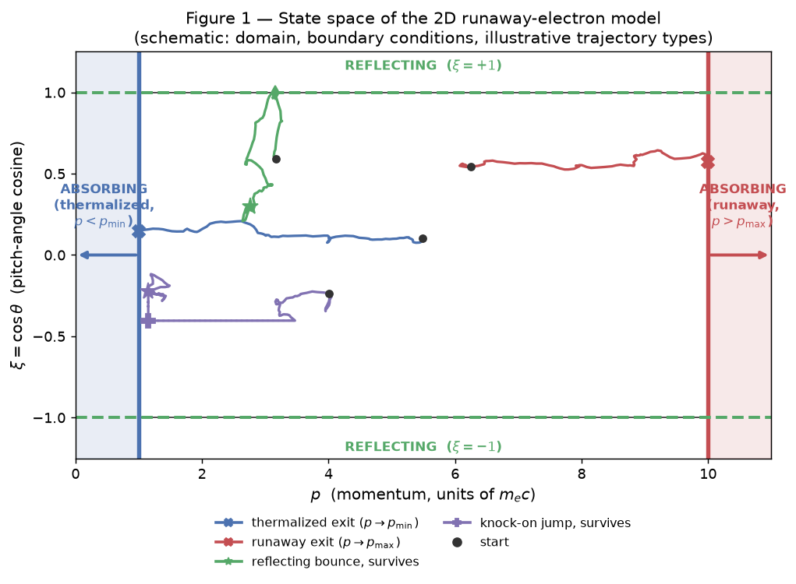
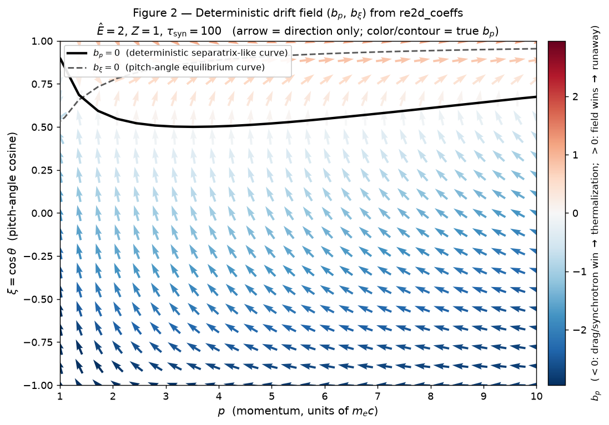
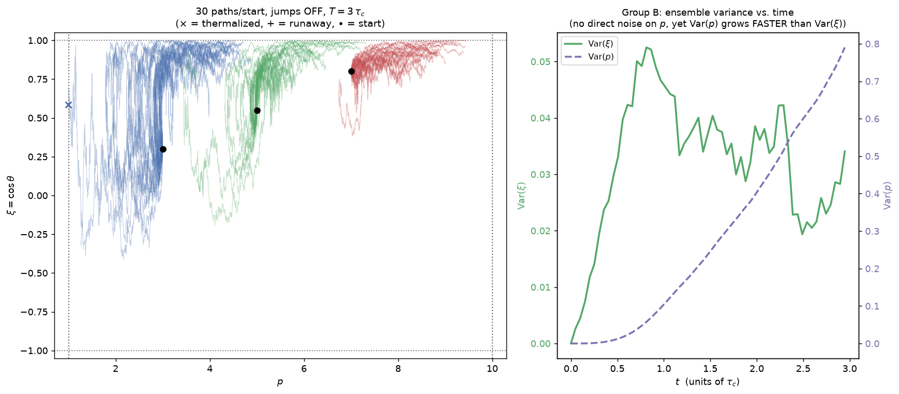
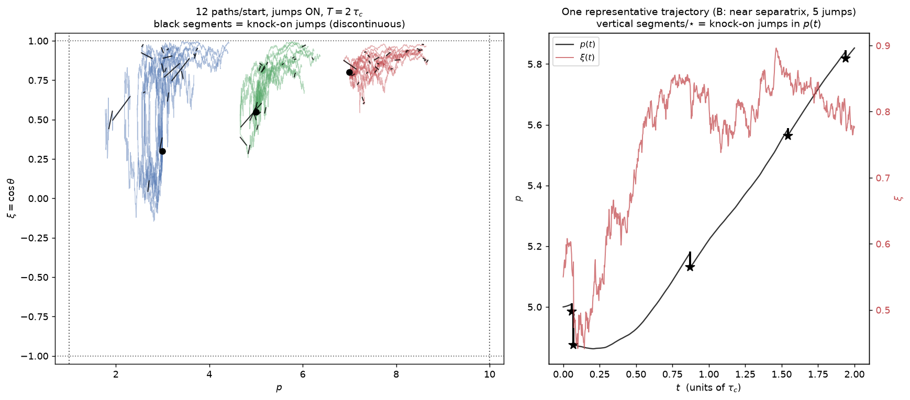
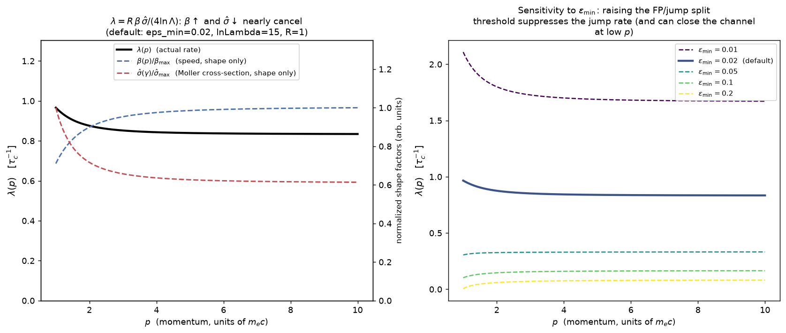
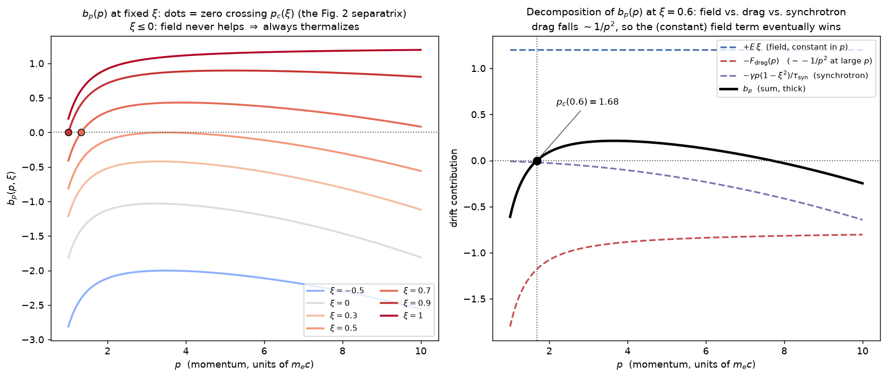
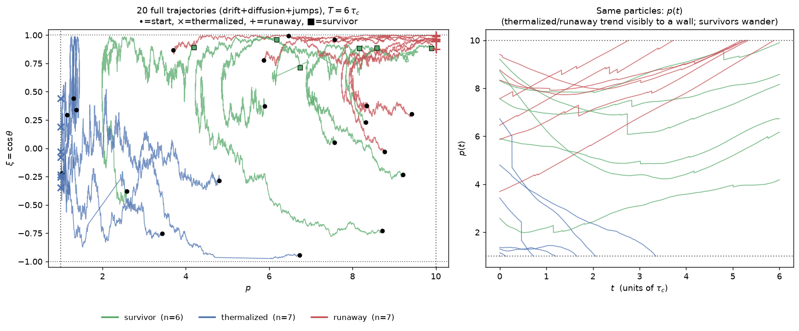
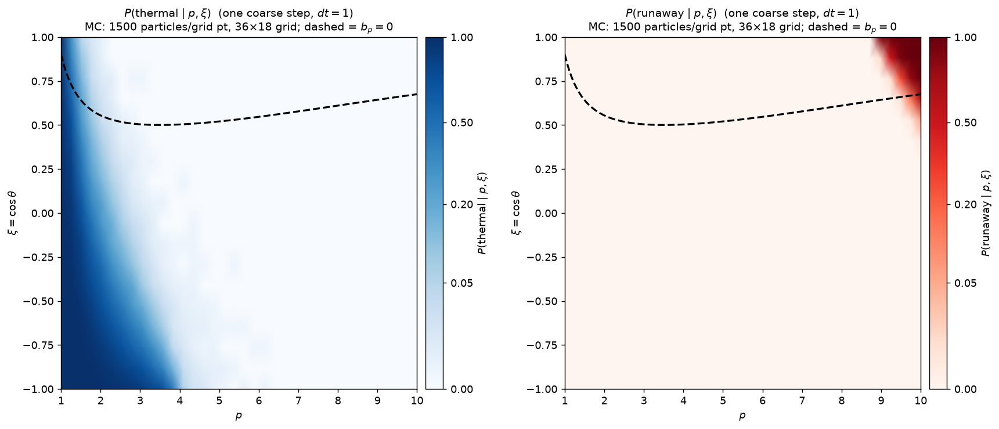

---

## 6. Problem 3 — 2D runaway-electron model: learned surrogate results

Trained on GPU (NVIDIA RTX A5000): flow map (`FN_Net`, distilled from
training-free diffusion labels) + 3-class exit classifier (`ExitNet`,
stay/thermalize/runaway), then combined exit-then-propagate for inference.
Full hyperparameters are in `code_2d/artifacts_re2d/config.json`.

| Fig | File | Description |
|---|---|---|
| P3.9 | `figures/problem3_ml/B0_onestep.png` | One-step accuracy at two fixed starts $(p,\xi)=(2,0.6)$ and $(5,0.9)$: ML flow map vs numerical survivor densities in $p$ and in $\xi$, with the matched 3-class exit probabilities in each title. |
| P3.10 | `figures/problem3_ml/B1_exit_maps.png` | Exit-probability maps: trained `ExitNet` vs fresh Monte Carlo (same grid as P3.8) — near-visually-identical; the classifier even smooths over MC sampling noise rather than overfitting to it. |
| P3.11 | `figures/problem3_ml/B2_rollout.png` | Long rollout to $T=10$ (10 big ML steps vs 4000 numerical sub-steps): survival + runaway fraction per step, and terminal $p$/$\xi$ distributions. |

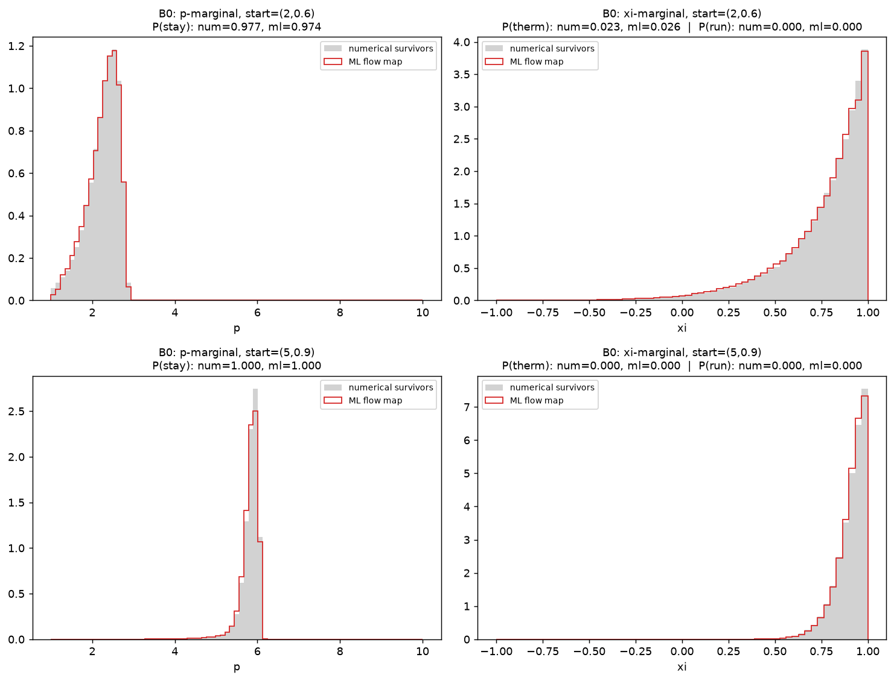
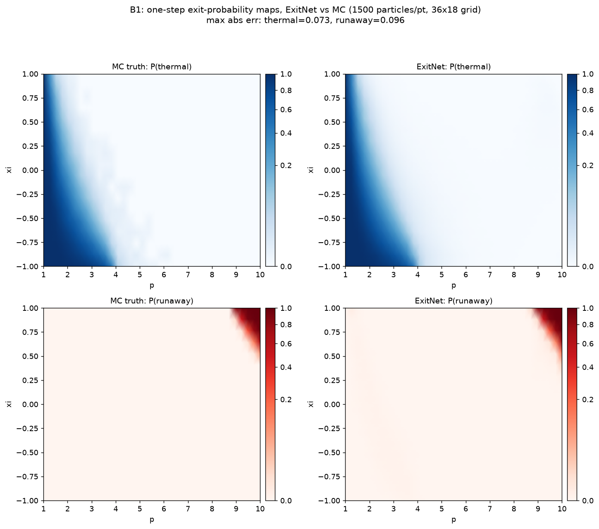
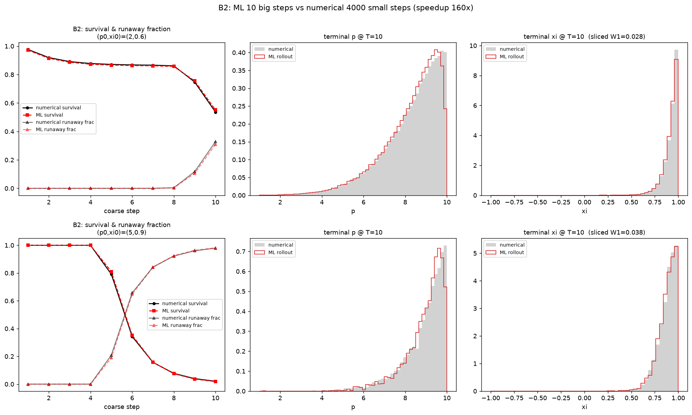

**Numbers** (`code_2d/artifacts_re2d/metrics.json`):

| Metric | $(p_0,\xi_0)=(2,0.6)$ | $(p_0,\xi_0)=(5,0.9)$ |
|---|---|---|
| B0 $P(\text{stay})$: numerical / ML | 0.977 / 0.974 | 1.000 / 1.000 |
| B0 flow-map "escape" fraction (out-of-domain error) | 0.0013 | 0.0 |
| B2 final survival: numerical / ML | 0.536 / 0.551 | 0.021 / 0.018 |
| B2 final runaway fraction: numerical / ML | 0.329 / 0.309 | 0.979 / 0.982 |
| B2 terminal sliced-Wasserstein-1 | 0.028 | 0.038 |

| B1 exit-map error (whole domain, 36×18 grid, 1500 MC/pt) | Value |
|---|---|
| Mean abs error, $P(\text{thermal})$ | 0.002 |
| Mean abs error, $P(\text{runaway})$ | 0.0005 |
| Max abs error, $P(\text{thermal})$ | 0.073 |
| Max abs error, $P(\text{runaway})$ | 0.096 (worst point: near $p\to p_{\max}$, $\xi\to1$ — the sharpest front) |

| B2 speed comparison | Value |
|---|---|
| ML wall-clock (10 big steps, GPU) | 0.73 s |
| Numerical wall-clock (4000 fine sub-steps, CPU) | 117.2 s |
| **Speedup** | **160×** |

---

## 7. Overall conclusions (poster-ready bullet points)

- A jump-diffusion flow map + exit classifier, trained *without* ever
  backpropagating through the SDE itself (training-free diffusion labels +
  supervised distillation), reproduces one-step and long-horizon (10-step)
  statistics of the true 2D runaway-electron model to within a few percent,
  while being **160× faster** than the reference fine integrator.
- Errors concentrate exactly where the physics predicts they should be
  hardest: the steep one-step exit fronts near each absorbing wall (P3.8,
  P3.10) — evidence the model learned real structure, not noise.
- Going from constant coefficients (Problem 1) to state-dependent
  coefficients (Problem 2) increased the exit classifier's worst-case error
  5×, foreshadowing exactly the difficulty seen in the full 2D exit
  classifier — a consistent, physically-explainable difficulty pattern
  across all three problems.
- The deterministic drift field alone ($b_p=0$ nullcline, P3.2/P3.6)
  correctly predicts the *qualitative* location of the runaway separatrix,
  but the actual one-step exit probability (what the ML classifier has to
  learn) is a much narrower boundary-layer object (P3.8) — an important,
  verified distinction between "eventual fate" and "one coarse step."
- A counter-intuitive, numerically-confirmed physics result along the way
  (P3.3): even though momentum $p$ has no direct stochastic term, its
  ensemble variance grows *faster* than the directly-diffused pitch angle
  $\xi$, because $p$ integrates the history of $\xi$'s random walk.

---

## 8. References

1. M. N. Rosenbluth, S. V. Putvinski, "Theory for avalanche of runaway
   electrons in tokamaks," *Nucl. Fusion* **37**, 1355 (1997).
2. O. Embréus, A. Stahl, T. Fülöp, "On the relativistic large-angle
   electron collision operator for runaway avalanches in plasmas," *J.
   Plasma Phys.* **84**, 905840102 (2018).
3. M. Yang, G. Zhang, D. del-Castillo-Negrete, M. Stoyanov, "A Feynman–Kac
   based numerical method for the exit time probability of a class of
   transport problems," *J. Comput. Phys.* **444**, 110564 (2021).
4. Y. Liu, M. Yang, Z. Zhang, F. Bao, Y. Cao, G. Zhang, "Diffusion-model-
   assisted supervised learning of generative models for density
   estimation," *J. Mach. Learn. Model. Comput.* **5**(1), 25–38 (2024).
5. M. Yang, Y. Liu, D. del-Castillo-Negrete, Y. Cao, G. Zhang, "Generative
   AI models for learning flow maps of stochastic dynamical systems in
   bounded domains," *J. Comput. Phys.*, 114434 (2025).
6. Zhang & del-Castillo-Negrete, *Phys. Plasmas* **24**, 092511 (2017),
   arXiv:1708.00947 — normalized 2D runaway-electron test-particle model
   (source of Eqs. 3–4 above).
7. Project internal note: `2D_runaway_example_note.pdf` /
   `2D_runaway_example_note.tex` (this repo, `Diffusion_CPP/`).

---

## 9. Quick figure index (for copy-paste into slides)

| Label | Path |
|---|---|
| P1.1–P1.3 | `figures/problem1_bd/{B0_onestep,B1_onestep,B2_rollout}.png` |
| P2.1–P2.3 | `figures/problem2_bsd/{B0_onestep,B1_onestep,B2_rollout}.png` |
| P3.1–P3.8 | `figures/problem3_physics/fig01..fig08_*.png` |
| P3.9–P3.11 | `figures/problem3_ml/{B0_onestep,B1_exit_maps,B2_rollout}.png` |

Raw metrics JSON, if you want exact numbers beyond what's tabulated above:
- `../runaway_flowmap/artifacts_bd/metrics.json`
- `../runaway_flowmap/artifacts_bsd/metrics.json`
- `../code_2d/artifacts_re2d/metrics.json` (also has `config.json` alongside
  it with every hyperparameter used for the 2D run)
